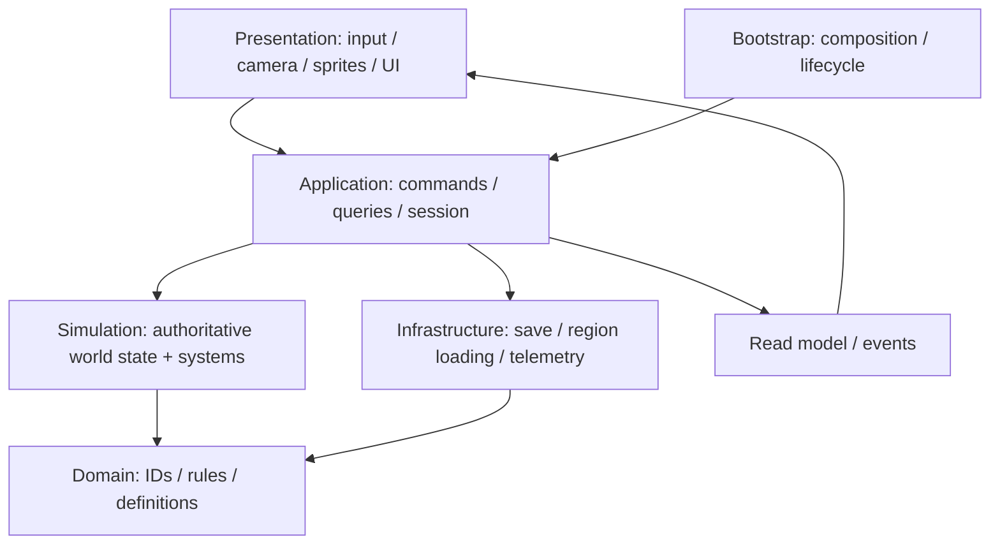

# AGENTS.md — SCRAP NATION

Инструкции для разработчиков и coding-агентов. Область действия: весь репозиторий, если в подкаталоге нет более конкретного AGENTS.md. Читайте вместе с [README.md](README.md).

Статус: архитектурный baseline для pre-production / MVP. Это правила для будущего кода, а не описание уже реализованной игры. Не создавайте пустые системы только ради соответствия этому документу.

## 1. Приоритеты проекта

- MVP проверяет автономное развитие NPC, авторство игрока, захват ресурсов и переезд. Сначала играбельный вертикальный срез, затем плейтест.
- Игрок создаёт условия работы и развития, а не покупает каждого юнита. NPC сохраняет личность при смене профессии/региона.
- Залежи конечны; богатство и время стоянки повышают угрозу. Переезд сохраняет жителей и часть имущества.
- Захват спота не равен награде: нужно извлечь и доставить добычу.
- Не расширять MVP за счёт MMO, глобальной карты, сложной экономики, потребностей и контента до проверки ядра.

## 2. Технологический baseline

| Область | Решение |
| --- | --- |
| Unity | 6.6 (6000.6.x); точная версия — ProjectSettings/ProjectVersion.txt |
| Рендер / ввод | Universal 2D (URP), Orthographic, Input System |
| Язык / платформа | C#, профиль .NET выбранного Unity; PC/Windows, одиночный MVP |
| Архитектура | Hybrid, data-oriented, фиксированный tick |
| Представление | GameObjects, MonoBehaviour, SpriteRenderer, Animator |
| Данные | ScriptableObject для авторинга; runtime state и save DTO отдельно |
| DOTS | Entities / Jobs / Burst / Collections — по разделу 5 |
| VCS | Git, .meta, Force Text, Git LFS для согласованных крупных ассетов |

Cinemachine и 2D Animation — при необходимости. Источник истины о пакетах: `Packages/manifest.json` и `Packages/packages-lock.json`. Проверять API установленной версии. Не обновлять движок/пакеты и не добавлять обязательные preview/experimental зависимости без согласования. Unity 6.7 LTS — кандидат после теста миграции.

## 3. Границы архитектуры



- **Domain / Simulation:** правила и единственное авторитетное состояние. В MVP чистый C# без UnityEngine, сцен, UI и файловой системы; симуляция работает без визуальных объектов.
- **Application:** жизненный цикл сессии, очередь команд, координация систем, read models и события. Игрок/ИИ передают намерения.
- **Presentation:** ввод, спрайты, анимация, звук, UI, интерполяция. Читает состояние и отправляет команды; не начисляет ресурсы, урон, XP. Animation events — для эффектов.
- **Infrastructure:** сохранения, загрузка регионов, Unity-адаптеры, телеметрия. Bootstrap явно связывает зависимости и управляет lifecycle.

Зависимости направлены к правилам, без циклов. Application определяет необходимые порты хранения, Infrastructure их реализует. Один composition root на сессию; без глобальных mutable singleton, service locator, универсальной DI и интерфейсов на каждый класс.

Команды (`BuildCommand`, `SetPriorityCommand`, `MigrateCommand`) валидируют цель, ресурсы, полномочия. События (`NpcUpgraded`, `ResourceDeposited`) публикуются после изменения. UI отображает результат, а не изменяет состояние напрямую.

## 4. Симуляция, идентичность и порядок выполнения

### Время и порядок

- Один `SimulationClock` (или эквивалент): стартово 20 ticks/s (50 ms), настраиваемо. Движение/бой каждый tick; AI каждые 4–5 ticks со сдвигом между NPC; периодическая экономика ~1 Hz; транзакции по завершении действий.
- `Step(tick)` не зависит от FPS. Таймеры в ticks или однозначных единицах; seed и явный RNG. Без Time.time, DateTime.Now, глобального UnityEngine.Random в правилах.
- Accumulator с лимитом catch-up steps; не терять тики молча. При перегрузке фиксировать backlog и политику замедления. Pause останавливает игровое время, не UI. Views интерполируют snapshots. Tick и seed не гарантируют сетевую/межплатформенную детерминированность.

Предлагаемый порядок tick:

1. Принять/проверить команды; обновить цели и зоны.
2. Выбрать/зарезервировать задачи; выполнить движение.
3. Разрешить бой, смерть и контроль спотов.
4. Завершить допустимые сбор, доставку, строительство и улучшения.
5. Обновить угрозу, спавн и lifecycle; применить отложенные изменения.
6. Сформировать события/read model.

Стабильный порядок спорных операций (tick + sequence); не зависеть от порядка Dictionary, Update или jobs. Мёртвый NPC не завершает сдачу. Дополнительные фазы документировать.

### Модель мира

- Типизированные постоянные ID: `NpcId`, `RegionId`, `ResourceNodeId` и аналоги для зданий, фракций, караванов. Не использовать InstanceID, Transform, индекс массива или Unity.Entities.Entity как постоянный ID.
- Runtime-state: принадлежность, регион, позиция, профессия, задача, здоровье, экипировка, личный прогресс. ID сохраняется при миграции; пул views привязывается к ID и очищает старое состояние при возврате.
- Immutable definitions отдельно от mutable state. ScriptableObject считывается в данные на старте, игровой прогресс не записывается в asset.
- MVP: движение по X, интервалы/зоны; без NavMesh, многоэтажной навигации и физического тела на каждый предмет. Если нужна Physics 2D, определить адаптер и единственного владельца позиции; не двигать Transform и simulation независимо.
- Незагруженный регион — данные, не скрытая сцена. Simulation LOD и фоновые регионы после MVP.

## 5. ECS, DOTS и производительность

**Hybrid, ECS-ready; не ECS everywhere.**

1. P0: компактная C#-симуляция с централизованными системами, без обязательного Unity Entities. Не писать собственный универсальный ECS.
2. После рабочего цикла — benchmark/spike: сравнить C# и Entities на одинаковых задачах. Jobs, Burst, Collections вводить при измеримой пользе.
3. Кандидаты на перенос: массовые NPC, движение, поиск целей, добыча и бой. Один модуль за раз; сохранить команды, тесты и контракт сохранений. ECS — единственный владелец перенесённого состояния; не дублировать production-логику в GameObjects.
4. В Entities использовать unmanaged IComponentData/buffers, ISystem и Burst/Jobs где применимо; structural changes через ECB и явный playback. Соблюдать dependencies, lifetime, disposal NativeContainers и safety checks. Baking/SubScenes по необходимости.
5. MVP-views: пул GameObjects/SpriteRenderer. Graphics.RenderSprite / RenderSpriteInstanced — отдельный эксперимент для простых массовых спрайтов; проверить API, сортировку, URP 2D, освещение, шейдеры и CPU/GPU. Сложная анимация пока остаётся в GameObjects.
6. Entities Graphics, Netcode for Entities, свой рендер-пайплайн и Physics Core 2D — не обязательный путь MVP.

### Performance rules

- В горячих путях избегать LINQ, строковых логов, аллокаций, Find/GetComponent каждый кадр и частого Instantiate/Destroy; кэшировать и использовать пулы по необходимости.
- Не выполнять поиск всех NPC × всех целей каждый tick. Реестр целей, reservations, распределённые обновления, spatial index по X при необходимости.
- Jobs не обращаются к UnityEngine.Object/managed API; мост к views на main thread, без Complete на каждую сущность.
- Benchmark: 50/100/250/500/1000/5000 NPC, одинаковые seed, сценарий, длительность, настройки и железо; Development Build с прогревом. Метрики: p50/p95 frame/tick, GC alloc, память, корректность; отдельно симуляция, рендер, анимация, физика и UI.
- 60 FPS — ориентир PC, не обещание. Бюджеты и целевые устройства уточняются по замерам; оптимизации проверять до/после.

## 6. Правила игровых систем

| Модуль | Инвариант / минимальный контракт |
| --- | --- |
| NPC / AI | FSM: поиск → движение → сбор → сдача/экипировка → улучшение; тревога прерывает работу, после боя NPC возвращается к ней. Utility AI — позже, если FSM не хватает. |
| Points of interest | Кучи, здания, рабочие слоты и зоны регистрируются/удаляются явно. Reservation освобождается при отмене, смерти, исчезновении цели или переезде. Нет бесконечного спавна без свободных возможностей. |
| Scavenging | Конечный запас; атомарное извлечение и перенос груза; нельзя забрать больше остатка или вместимости. Видимое уменьшение кучи следует из её состояния. |
| Economy | Целые единицы хлама, отдельно личный прогресс NPC. Единственный учётчик транзакций; проверка баланса до изменения; нет отрицательных запасов или дублирования. |
| Professions | Сборщик с тележкой сдаёт хлам в ломбард → гарпунщик; ближник последовательно собирает броню → металлоприёмник → железник. Улучшение сохраняет ID, меняет профессию/экипировку и оплачивается один раз. |
| Buildings | Флаг, ломбард, металлоприёмник, ограда и ремонт. Постройка валидирует площадку, границы и стоимость. Здания объявляют возможности, не управляют всей логикой NPC. |
| Combat | Один авторитетный расчёт здоровья, урона, брони и потраченного груза. Снаряд/анимация не начисляют повторный урон или ресурсы. Использованный для атаки хлам списывается. |
| Threat director | Конфигурируемые риск района + богатство + время стоянки; предупреждение, окна восстановления, ограничения роста. Богатство учитывает запас, постройки и экипировку; конвертация ресурса в здание не обнуляет угрозу. |
| Resource spots | Open → Capturing → Held/Extracting; Contested при конкуренции; Lost/Depleted при потере/истощении. Контроль и новые циклы добычи останавливаются при оспаривании. Только доставленные партии дают награду. |
| Caravan | Переносит личности, прогресс, экипировку и допустимый груз; здания остаются либо дают частичную стоимость при разборе. Время стоянки сбрасывается для нового лагеря, а базовый риск определяется новым районом. |

Любая операция переноса предмета (куча → NPC → город → экипировка/расход) должна уменьшать источник и увеличивать получателя в одном логическом изменении. При нехватке ресурсов операция целиком отклоняется либо выполняется явно предусмотренная частичная доставка; не оставлять частично списанные средства. Не дублировать стоимость временной брони при сдаче и переплавке. События и UI не повторяют транзакцию.

Числа баланса не хардкодить по системам: один набор definitions/config. Первые настройки из README — гипотезы для плейтеста, а не неизменные правила.

## 7. Переезды, сохранения и будущий онлайн

- Versioned save DTO: версия схемы, tick, RNG state, мир/регионы, стабильные ID, состояние NPC, экипировка, груз и сохраняемые здания/залежи. Без сырых ECS chunks, runtime handles, GameObjects и делегатов. Definition IDs отдельно от instance IDs; не переиспользовать ID в кампании.
- Снимок на границе tick. Запись через временный файл/безопасную замену; ошибки и схема проверяются. Не перезаписывать неизвестный или повреждённый save молча.
- Переезд: проверить вместимость/участников → manifest → отмена/завершение задач и reservations → согласованный snapshot и груз → загрузка нового района → восстановление NPC/views. Повтор команды не дублирует людей или груз; при ошибке сохранить последнее согласованное состояние.
- MVP допускает одну переиспользуемую сцену с параметрами района. Не реализовывать бесшовный мир.
- Будущий multiplayer: server-authoritative, валидируемые команды, snapshots. MVP — локальный authority и ИИ. Transport, prediction, rollback, аккаунты, backend не нужны сейчас.

## 8. Предлагаемая структура Unity-проекта

Если Unity-проект ещё не импортирован, использовать следующую структуру при первом соответствующем изменении. Не создавать заранее все пустые каталоги. Если проект окажется в подкаталоге, адаптировать пути к фактическому корню Unity.

```text
Assets/_ScrapNation/
  Art/
  Audio/
  Prefabs/
  Scenes/                   # Bootstrap, Prototype, Benchmark по мере необходимости
  Settings/                 # авторинг definitions и config
  Scripts/
    Domain/                 # чистые правила, идентификаторы, value types
    Simulation/             # NPC, Resources, Economy, Combat, World...
    Application/            # tick/session, commands, queries
    Infrastructure/         # persistence, Unity adapters, telemetry
    Presentation/           # player input, views, camera, UI
    Bootstrap/
    Editor/                 # editor-only инструменты
  Tests/
    EditMode/
    PlayMode/
Docs/                       # ADR и подробные спецификации по мере появления
```

Namespace: `ScrapNation.<Layer>[.<Feature>]`. Вводить asmdef по реальным границам: Domain, Simulation, Application, Infrastructure, Presentation, Bootstrap, отдельно Editor и Tests. Чистые сборки с `noEngineReferences`, где возможно. ECS-реализация, если утверждена, отдельной сборкой с зависимостями от установленных DOTS-пакетов. Не создавать циклические ссылки. Не использовать namespace `Unity` для собственных типов.

## 9. Стиль C# и Unity-ассеты

- Английские имена: PascalCase для типов/методов/свойств, camelCase для локальных, _camelCase для private fields. 4 пробела, UTF-8, LF, один основной public тип на файл; учитывать .editorconfig.
- Узкие публичные контракты, явные единицы (DurationTicks, Capacity), без магических чисел и необоснованных reflection/unsafe. Комментарии объясняют причину. Документация на русском допустима; commit messages и имена файлов английские.
- Unity: [SerializeField] private, валидация ссылок, явный lifecycle без случайного Awake/Start/Update порядка. Отписки, остановка jobs, очистка пулов; проверить повторный Play Mode.
- Visible Meta Files + Force Text. Сохранять GUID, перемещать ассеты вместе с .meta предпочтительно через Editor. Не придумывать GUID для существующих объектов и не править крупный scene/prefab YAML без проверки.
- В Git: Assets, Packages, ProjectSettings и .meta. Не коммитить Library, Temp, Obj, Logs, UserSettings, builds и IDE-кэш. Следовать .gitignore; Git LFS для согласованных крупных бинарных ассетов.
- Сторонние ассеты/пакеты только с понятной лицензией. Без секретов, токенов, личных данных и локальных абсолютных путей.

## 10. Проверки и Definition of Done

Для каждого игрового изменения предусмотреть проверяемый критерий. Использовать Unity Test Framework; EditMode для чистой логики, PlayMode для сцены и интеграций. Воспроизводимые тесты с заданным seed и без зависимости от FPS/реального времени.

Минимальные регрессионные проверки по мере реализации:
- конечный запас, два сборщика на последнем ресурсе, переполненная тележка;
- сдача, строительство и расход не создают хлам из воздуха; недостаток ресурса не меняет состояние;
- броня добавляется по одному элементу, не выходит за cap; улучшение единожды сохраняет ID;
- отмена задачи / смерть / удаление точки освобождает reservation;
- угроза зависит от богатства и времени стоянки; строительство не обнуляет накопленную угрозу;
- оспариваемый спот не начинает новый сбор, доставленная добыча остаётся;
- переезд и save/load сохраняют ID, экипировку, прогресс и груз без дубликатов;
- повторный вход в сцену не создаёт лишних подписок, таймеров и NPC;
- UI и views отражают состояние без самостоятельной модификации экономики.

Пример запуска тестов при наличии Unity (путь к редактору и корню проекта задаются локально):

```sh
"<UnityEditor>" -batchmode -nographics -projectPath "<UnityProjectRoot>" -runTests -testPlatform EditMode -testResults "<OutputDir>/editmode.xml" -logFile "<OutputDir>/editmode.log"
"<UnityEditor>" -batchmode -projectPath "<UnityProjectRoot>" -runTests -testPlatform PlayMode -testResults "<OutputDir>/playmode.xml" -logFile "<OutputDir>/playmode.log"
```

Подготовить OutputDir; на CI выбрать поддерживаемый runner, лицензию и при необходимости графическое окружение. Не добавлять -quit к запуску Test Framework, если это может завершить тесты преждевременно. При отсутствии редактора/лицензии честно указать, какие проверки не запущены; не выдавать статический просмотр кода за компиляцию или успешный PlayMode.

Done означает: задача в нужном объёме, код и ссылки на ассеты согласованы, нет новых ошибок компиляции и неожиданных ошибок Console в затронутом сценарии, тесты/ручная проверка выполнены и описаны либо ограничения явно названы, документация обновлена при изменении контрактов. Не маскировать проблемы через удаление тестов или отключение валидаторов.

## 11. Порядок работы агента

1. Прочитать README, AGENTS.md и применимые вложенные инструкции; проверить git status, реальную структуру, версии и тесты. Не предполагать, что описанные классы уже существуют.
2. Определить ближайшую задачу MVP, критерий готовности и небольшой план. Выбрать минимальный обратимый срез; отметить допущения.
3. Переиспользовать контракты; не менять чужие незакоммиченные правки и несвязанный код, не генерировать заглушки/абстракции впрок.
4. Проверить diff, compile/test/Play Mode при доступности; добавить тесты изменённых правил. Не заявлять непроведённые проверки успешными.
5. Отчёт: результат, файлы, проверки и фактический статус, риски, следующий шаг; для сцен — воспроизводимые действия в Editor.
6. Малые тематические коммиты: feat:, fix:, test:, docs:, refactor:, chore:. Значимые изменения — рабочая ветка/PR. Не force-push, не менять историю main, ветки или настройки без запроса. Публиковать/сливать только по поручению.

Согласовать изменение Unity/обязательных зависимостей, authority, несовместимой save-схемы, основных игровых правил, лицензии, платных/сетевых сервисов и объёма MVP. Для крупных решений — короткий ADR в Docs/Architecture/ (контекст, альтернативы, решение, последствия, дата, статус).

**Главное:** сначала NPC самостоятельно находит мусор, собирает его, сдаёт, меняется и становится ценным для игрока. Технологии служат этому циклу.

