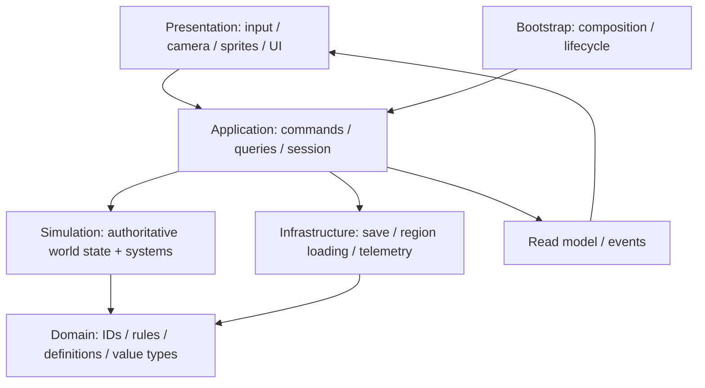

# AGENTS.md — SCRAP NATION

Инструкции для разработчиков и coding-агентов. Область действия: весь репозиторий, если в подкаталоге нет более конкретного AGENTS.md. Читайте вместе с [README.md](README.md).

Статус: архитектурный baseline для pre-production / MVP. Это правила для будущего кода, а не описание уже реализованной игры. Не создавайте пустые системы только ради соответствия этому документу.

## 1. Приоритеты проекта

- Цель MVP — проверить интерес к автономному развитию жителей, влиянию игрока на общество, борьбе за ресурсы и переездам. Не реализовывать весь GDD сразу.
- Игрок управляет героем и условиями жизни NPC; индивидуальные приказы — исключение. Не превращать игру в обычную RTS с покупкой каждого юнита.
- NPC — постоянные личности. Смена профессии, экипировки, сцены или визуального объекта не создаёт нового жителя.
- Источники ресурсов конечны; угроза растёт с богатством и временем стоянки. Переезд сохраняет людей и часть накопленного имущества.
- Захват ресурсного спота не равен награде: добыча должна быть извлечена и доставлена.
- Сначала минимальный играбельный вертикальный срез, затем измерение, тест и итерация. Не проектировать гипотетический MMO-сервер или универсальный игровой движок заранее.

## 2. Технологический baseline

| Решение | Правило |
| --- | --- |
| Unity | 6.6 (6000.6.x), точная версия — из `ProjectSettings/ProjectVersion.txt` после первого импорта проекта |
| Рендер | Universal 2D / URP, ортографическая камера |
| Код | C#, совместимый с выбранной версией Unity и её профилем .NET |
| MVP | Одиночная игра, PC/Windows, клавиатура и мышь |
| Ввод | Unity Input System, действия вместо жёсткой привязки к клавишам |
| Камера / анимация | Cinemachine и 2D Animation при необходимости и совместимости |
| Симуляция | Data-oriented, фиксированный tick, независимость от визуализации |
| Представление | GameObjects, MonoBehaviour, SpriteRenderer, Animator |
| DOTS | Unity Entities / Jobs / Burst / Collections — по плану из раздела 5 |
| Данные | ScriptableObject для авторинга; runtime-state и save DTO отдельно |
| VCS | Git, Unity .meta, текстовая сериализация; Git LFS для согласованных крупных бинарных ассетов |

Не обновлять Unity, URP, Input System, Entities или другие зависимости без согласования. Источник истины для установленных пакетов — `Packages/manifest.json` и `Packages/packages-lock.json`. Проверяйте API в документации конкретной версии пакета и редактора. Не использовать preview/experimental API в обязательном пути MVP без отдельного решения. Unity 6.7 LTS — кандидат на последующую миграцию, а не автоматическое обновление.

## 3. Границы архитектуры



- **Domain / Simulation**: правила, состояние мира и системная логика. Для MVP обычный C# без зависимости от UnityEngine, сцен, GameObjects, UI и файловой системы. Состояние обрабатывается централизованно. Не требовать визуальных объектов для запуска симуляции или тестов.
- **Application**: жизненный цикл игровой сессии, очередь команд, проверки, координация систем, read models и события. Герой, NPC и ИИ-соперники передают намерения, а не напрямую переписывают чужое состояние.
- **Presentation**: ввод, камера, визуальные NPC, интерполяция, звук, VFX, UI. Читает состояние и отправляет команды; не владеет балансом, HP, инвентарём и профессиями. Animator и animation events могут запускать эффекты, но не решают исход боя и не начисляют ресурс.
- **Infrastructure**: сохранения, загрузка регионов, Unity-адаптеры, локальная телеметрия. Форматы хранения не определяют игровые правила.
- **Bootstrap**: один явный composition root на игровую сессию. Создаёт зависимости, подписывает/отписывает адаптеры, освобождает ресурсы. Избегать глобальных статических mutable singleton, service locator и скрытого поиска объектов по сцене.

Направление зависимостей — от внешних слоёв к правилам, без циклов. Application может определять узкие интерфейсы для внешнего хранения, которые реализует Infrastructure; связывает их Bootstrap. Не заводить универсальную DI/IoC-систему, шину событий или интерфейс для каждого класса. Добавляйте границы там, где они решают конкретную задачу.

Команды (например, `BuildCommand`, `SetPriorityCommand`, `MigrateCommand`) валидируются в симуляции/application: доступны ли действие, ресурсы и цель. События (`NpcUpgraded`, `ResourceDeposited`) публикуются после успешного изменения состояния. UI читает результат, а не оптимистично изменяет игровое состояние.

## 4. Симуляция, идентичность и порядок выполнения

### 4.1. Время

- Один владелец игрового времени (`SimulationClock` или эквивалент). Начальная настройка — 20 ticks/s (50 ms), настраиваемая и не окончательная.
- `Step(tick)` принимает команды и выполняет системы в явно заданном порядке. Рендер и частота FPS не влияют на экономику, боевые таймеры и прогресс NPC.
- Стартовые интервалы: движение и бой — каждый tick; выбор цели NPC — каждые 4–5 ticks со сдвигом между агентами; периодическая экономика/производство — около 1 Hz. Сдача хлама и затраты применяются при завершении действия, а не ждут отдельного экономического tick.
- Таймеры правил хранить в ticks или в однозначно конвертируемых единицах. Не использовать `Time.time`, `DateTime.Now` и глобальный `UnityEngine.Random` в правилах. Вводить seed и явный генератор случайности для воспроизводимости тестов.
- Использовать accumulator и ограничение catch-up steps за кадр; не терять тики молча. При длительном отставании измерять backlog и явно определять политику замедления. Pause останавливает игровое время, а не интерфейс.
- Отдельные визуальные кадры интерполируют позиции между snapshots. Не обещать сетевую или побитовую детерминированность на разных платформах: фиксированный tick и seed сами по себе её не гарантируют.

### 4.2. Предлагаемый порядок одного tick

1. Принять и проверить команды игрока и ИИ; обновить доступность целей и зон.
2. Выбрать/зарезервировать работу и цели; обновить движение.
3. Разрешить конфликт, урон, смерть и контроль ресурсных точек.
4. Завершить допустимые действия сбора, доставки, переработки, строительства и улучшений.
5. Обновить угрозу, спавн и переходы жизненного цикла; применить отложенные изменения коллекций.
6. Сформировать события/read model для UI, визуализации и телеметрии.

Системы, которым нужны дополнительные фазы, должны документировать их порядок. Мёртвый NPC не завершает сдачу в том же tick. Команды и спорные операции имеют явный стабильный порядок (например, tick + sequence), не зависящий от обхода Dictionary, Unity Update или выполнения job.

### 4.3. Модель мира

Использовать типизированные стабильные ID или эквивалентные однозначные ключи для NPC, зданий, залежей, регионов, фракций и караванов. Например `NpcId`, `RegionId`, `ResourceNodeId`. Не сохранять `GetInstanceID()`, ссылку на Transform, индекс массива или Unity.Entities.Entity в качестве постоянной личности.

- Runtime-state хранит идентичность, принадлежность, регион/позицию, профессию, текущую задачу, здоровье, экипировку и личный прогресс; состав зависит от реализованного MVP.
- NPC может менять регион и визуальный объект без изменения ID. Визуальный пул сопоставляет ID с текущим представлением; при возврате в пул удаляет старые подписки и состояние.
- Отделить immutable definitions (параметры профессий, рецептов, зданий, типов ресурсов) от mutable state. ScriptableObject — источник авторинга; на старте сессии считывается в данные симуляции. Не записывать игровой прогресс обратно в asset.
- Для MVP — плоская боковая карта, движение по X и простые интервалы/зоны. Не внедрять NavMesh, произвольную многоэтажную навигацию или физическое тело для каждого предмета мусора. Если Unity Physics 2D нужна для gameplay, оформить явный адаптер и единый источник истины; не двигать Transform и симуляцию независимо.
- Незагруженный регион — данные, а не скрытая Unity-сцена. Полноценная фоновая симуляция и LOD регионов нужны только после проверки MVP.

## 5. ECS, DOTS и производительность

**Стратегия: hybrid, ECS-ready; не ECS everywhere.**

1. P0: реализовать малый сквозной цикл на компактных структурах/коллекциях C# с системами, отделёнными от GameObjects. Не писать собственный универсальный ECS или сложный контейнер компонентов.
2. После появления работающего цикла — отдельный benchmark/spike: сравнить централизованный C# и Unity Entities на одинаковых задачах. Jobs, Burst и Collections внедрять там, где это измеримо полезно и поддерживается пакетами.
3. Если принято решение о Unity Entities, симуляция массовых NPC, поиска целей, добычи, движения и боя — первые кандидаты. Переносить один модуль/вертикальный срез за раз, сохраняя тесты, публичные команды и контракт сохранений.
4. ECS становится единственным владельцем состояния перенесённой системы. Не поддерживать одновременно две независимые production-модели NPC (GameObject и Entity) и не копировать игровую логику в адаптеры.
5. В ECS: unmanaged `IComponentData`/buffers для горячих данных, `ISystem` и Burst/Jobs там, где применимо; structural changes через подходящий EntityCommandBuffer и контролируемые точки playback. Учитывать dependencies, lifetime и disposal NativeContainers; не обходить safety checks. Baking и SubScenes — только при реальной необходимости. Проверять API установленной версии Entities.
6. Представление MVP — пул GameObjects и SpriteRenderer. API `Graphics.RenderSprite` / `RenderSpriteInstanced` — отдельный рендер-эксперимент для массовых простых спрайтов; проверить доступность в редакторе, порядок сортировки, URP 2D, освещение, совместимость шейдеров и эффект на CPU/GPU. Не строить скелетную анимацию и экипировку вокруг экспериментальной оптимизации.
7. Не добавлять Entities Graphics, Netcode for Entities, собственный рендер-пайплайн и низкоуровневую 2D-физику в MVP без отдельной задачи/проверки.

### Performance rules

- Не делать `FindObjectOfType`, `GetComponent`, LINQ, строковые логи, лишние аллокации или создание/удаление GameObjects в горячем пути каждый кадр. Кэшировать ссылки; пулы вводить для подтверждённого частого создания объектов.
- Не сканировать все NPC × все точки/врагов каждый tick. Использовать реестр доступных целей, reservations, распределённые обновления; простой spatial index/интервалы по X — когда нужен.
- Jobs не обращаются к UnityEngine.Object/managed API. Мост к представлению выполняется безопасно на main thread; не форсировать Complete для каждой сущности.
- Профилировать отдельно симуляцию, рендер, анимацию, физику, GC и UI. Benchmark: 50/100/250/500/1000/5000 NPC, один seed и сценарий; сравнить p50/p95 времени кадра и tick, GC alloc, память и корректность результата. Использовать Development Build на описанном железе; прогрев, одинаковые настройки и длительность.
- 60 FPS — ориентир PC, не обещание. Целевые устройства и бюджеты CPU/GPU/tick уточняются по замерам. Не объявлять оптимизацию успешной без измерения до/после.

## 6. Правила игровых систем

| Модуль | Инвариант / минимальный контракт |
| --- | --- |
| NPC / AI | FSM: поиск → движение → сбор → сдача/экипировка → улучшение; тревога прерывает работу, после боя NPC возвращается к ней. Utility AI — позже, если FSM не хватает. |
| Points of interest | Кучи, здания, рабочие слоты и зоны регистрируются/удаляются явно. Reservation освобождается при отмене, смерти, исчезновении цели или переезде. Нет бесконечного спавна без свободных возможностей. |
| Scavenging | Конечный запас; атомарное извлечение и перенос груза; нельзя забрать больше остатка или вместимости. Видимое уменьшение кучи следует из её состояния. |
| Economy | Целые единицы хлама, отдельно личный прогресс NPC. Единственный учётчик транзакций; проверка баланса до изменения; нет отрицательных запасов или дублирования. |
| Professions | Сборщик с тележкой сдаёт хлам в ломбард → гарпунщик; ближник последовательно собирает броню → металлоприёмник → железник. Улучшение сохраняет ID, меняет профессию/экипировку и оплачивается один раз. |
| Buildings | Флаг, ломбард, металлоприёмник, ограда и ремонт. Постройка валидирует площадку, границы и стоимость. Здания объявляют возможности, не управляют всей логикой NPC. |
| Combat | Один авторитетный расчёт здоровья, урона, брони и потраченного груза. Снаряд/анимация не начисляют повторный урон или ресурсы. Использованный для атаки хлам списывается. |
| Threat director | Конфигурируемые риск района + богатство + время стоянки; предупреждение, окна восстановления, ограничения роста. Богатство учитывает запас, постройки и экипировку; конвертация ресурса в здание не обнуляет угрозу. |
| Resource spots | Open → Capturing → Held/Extracting; Contested при конкуренции; Lost/Depleted при потере/истощении. Контроль и новые циклы добычи останавливаются при оспаривании. Только доставленные партии дают награду. |
| Caravan | Переносит личности, прогресс, экипировку и допустимый груз; здания остаются либо дают частичную стоимость при разборе. Время стоянки сбрасывается для нового лагеря, а базовый риск определяется новым районом. |

Любая операция переноса предмета (куча → NPC → город → экипировка/расход) должна уменьшать источник и увеличивать получателя в одном логическом изменении. При нехватке ресурсов операция целиком отклоняется либо выполняется явно предусмотренная частичная доставка; не оставлять частично списанные средства. Не дублировать стоимость временной брони при сдаче и переплавке. События и UI не повторяют транзакцию.

Числа баланса не хардкодить по системам: один набор definitions/config. Первые настройки из README — гипотезы для плейтеста, а не неизменные правила.

## 7. Переезды, сохранения и будущий онлайн

- Save DTO не зависит от Unity-сцены и содержит версию схемы, tick, seed/состояние RNG (где нужно), глобальное состояние и регионы, ID и состояние жителей, экипировку, груз, здания и остатки залежей, если они должны сохраняться. Не сериализовать сырые ECS chunks, runtime handles, GameObjects или делегаты.
- Разделять definition IDs (тип ресурса/профессии) и instance IDs (конкретный NPC/здание). Не переиспользовать ID после смерти/удаления в рамках кампании.
- Снимок — на согласованной границе tick после применения изменений. Запись локального файла через временный файл/безопасную замену в поддерживаемой среде; обработка ошибок и проверка схемы. Не перезаписывать неизвестную версию/повреждённый save молча.
- Переезд: проверить вместимость и участников → сформировать manifest → завершить/отменить задания и reservations → зафиксировать состояние и груз один раз → загрузить/инициализировать регион → восстановить участников и их views. Повторный запуск команды не должен клонировать жителей или груз; обрабатывать ошибку загрузки без потери последнего согласованного состояния.
- Для MVP допустима повторно используемая сцена с разными параметрами района. Не создавать полноценный бесшовный мир.
- Будущий multiplayer — server-authoritative, команды валидируются владельцем мира, клиенты читают snapshots. Для MVP локальный authority и ИИ-конкуренты; не добавлять сетевой transport, prediction, rollback, аккаунты и backend. Возможность сети — архитектурная граница, а не заявление о готовности.

## 8. Предлагаемая структура Unity-проекта

Если Unity-проект ещё не импортирован, использовать следующую структуру при первом соответствующем изменении. Не создавать заранее все пустые каталоги. Если проект окажется в подкаталоге, адаптировать пути к фактическому корню Unity.

```text
Assets/_ScrapNation/
  Art/
  Audio/
  Prefabs/
  Scenes/                   # Bootstrap, Prototype, Benchmark по мере необходимости
  Settings/                 # авторинг definitions и config
  Scripts/
    Domain/                 # чистые правила, идентификаторы, value types
    Simulation/             # NPC, Resources, Economy, Combat, World...
    Application/            # tick/session, commands, queries
    Infrastructure/         # persistence, Unity adapters, telemetry
    Presentation/           # player input, views, camera, UI
    Bootstrap/
    Editor/                 # editor-only инструменты
  Tests/
    EditMode/
    PlayMode/
Docs/                       # ADR и подробные спецификации по мере появления
```

Namespace: `ScrapNation.<Layer>[.<Feature>]`. Вводить asmdef по реальным границам: Domain, Simulation, Application, Infrastructure, Presentation, Bootstrap, отдельно Editor и Tests. Чистые сборки с `noEngineReferences`, где возможно. ECS-реализация, если утверждена, отдельной сборкой с зависимостями от установленных DOTS-пакетов. Не создавать циклические ссылки. Не использовать namespace `Unity` для собственных типов.

## 9. Стиль C# и Unity-ассеты

- Понятные имена на английском: PascalCase для типов, методов и свойств, camelCase для локальных переменных/параметров, `_camelCase` для private fields. 4 пробела, UTF-8, LF, один основной public тип на файл; учитывать существующий .editorconfig.
- Узкие публичные контракты, private по умолчанию, явные единицы величин (`DurationTicks`, `Capacity`), говорящие имена вместо магических чисел. Не использовать reflection/unsafe без обоснования.
- Комментарии объясняют причину, инвариант или сложный порядок выполнения, а не пересказывают каждую строку. Документация может быть на русском; идентификаторы, commit messages и имена файлов — на английском.
- Unity lifecycle: сериализуемые зависимости `[SerializeField] private`, валидировать ссылки/конфиг, не полагаться на случайный порядок Awake/Start/Update. Отписываться от событий, останавливать jobs и очищать пулы при выгрузке. При изменении Enter Play Mode settings проверять повторный запуск сессии.
- Editor: Visible Meta Files и Force Text. Сохранять существующие GUID; перемещать ассет вместе с .meta предпочтительно через Unity Editor. Не придумывать .meta GUID для существующих объектов и не редактировать крупный scene/prefab YAML без необходимости и проверки в Unity.
- `Assets/`, `Packages/`, `ProjectSettings/` и соответствующие .meta — под Git. `Library/`, `Temp/`, `Obj/`, `Logs/`, `UserSettings/`, локальные build outputs и IDE-кэш — не коммитить. Следовать .gitignore; не переписывать его без задачи.
- Большие бинарные ассеты — через согласованный Git LFS и .gitattributes; не вносить сторонние ассеты/плагины без понятной лицензии. Никаких токенов, ключей, паролей, личных данных или локальных абсолютных путей в репозитории.

## 10. Проверки и Definition of Done

Для каждого игрового изменения предусмотреть проверяемый критерий. Использовать Unity Test Framework; EditMode для чистой логики, PlayMode для сцены и интеграций. Воспроизводимые тесты с заданным seed и без зависимости от FPS/реального времени.

Минимальные регрессионные проверки по мере реализации:
- конечный запас, два сборщика на последнем ресурсе, переполненная тележка;
- сдача, строительство и расход не создают хлам из воздуха; недостаток ресурса не меняет состояние;
- броня добавляется по одному элементу, не выходит за cap; улучшение единожды сохраняет ID;
- отмена задачи / смерть / удаление точки освобождает reservation;
- угроза зависит от богатства и времени стоянки; строительство не обнуляет накопленную угрозу;
- оспариваемый спот не начинает новый сбор, доставленная добыча остаётся;
- переезд и save/load сохраняют ID, экипировку, прогресс и груз без дубликатов;
- повторный вход в сцену не создаёт лишних подписок, таймеров и NPC;
- UI и views отражают состояние без самостоятельной модификации экономики.

Пример запуска тестов при наличии Unity (путь к редактору и корню проекта задаются локально):

```sh
"<UnityEditor>" -batchmode -nographics -projectPath "<UnityProjectRoot>" -runTests -testPlatform EditMode -testResults "<OutputDir>/editmode.xml" -logFile "<OutputDir>/editmode.log"
"<UnityEditor>" -batchmode -projectPath "<UnityProjectRoot>" -runTests -testPlatform PlayMode -testResults "<OutputDir>/playmode.xml" -logFile "<OutputDir>/playmode.log"
```

Подготовить OutputDir; на CI выбрать поддерживаемый runner, лицензию и при необходимости графическое окружение. Не добавлять -quit к запуску Test Framework, если это может завершить тесты преждевременно. При отсутствии редактора/лицензии честно указать, какие проверки не запущены; не выдавать статический просмотр кода за компиляцию или успешный PlayMode.

Done означает: задача в нужном объёме, код и ссылки на ассеты согласованы, нет новых ошибок компиляции и неожиданных ошибок Console в затронутом сценарии, тесты/ручная проверка выполнены и описаны либо ограничения явно названы, документация обновлена при изменении контрактов. Не маскировать проблемы через удаление тестов или отключение валидаторов.

## 11. Порядок работы агента

1. Прочитать README, этот файл и применимые вложенные AGENTS.md; проверить git status, фактическую структуру, версии Unity/пакетов и существующие тесты. Не предполагать, что описанные здесь классы уже есть.
2. Определить ближайшую задачу MVP, критерий готовности, необходимые файлы и небольшой план. Предпочитать минимальный end-to-end срез. Если постановка не уточняет параметры, выбрать обратимое решение, явно отметить допущение.
3. Переиспользовать существующие системы и контракты. Не рефакторить несвязанные модули, не менять пользовательские незакоммиченные правки, не генерировать пустые заглушки или абстракции впрок.
4. Проверить изменения (diff, compile/test/Play Mode при доступности). Добавить тесты для изменённых правил; зафиксировать причины непроведённых проверок и известные ограничения.
5. В отчёте назвать результат, изменённые файлы, проверки и их фактический статус, решения/риски, следующий шаг. Для изменений сцены описать воспроизводимые действия в Editor.
6. Малые тематические коммиты: `feat:`, `fix:`, `test:`, `docs:`, `refactor:`, `chore:`. Для значимых изменений использовать рабочую ветку/PR; не force-push, не удалять ветки, не менять историю main и настройки репозитория без явного запроса. Публиковать/сливать только в рамках поручения.

Согласовать с владельцем прежде, чем менять версию Unity, обязательные зависимости, архитектуру authority, схему сохранений несовместимым образом, основные игровые правила, лицензирование, платные/сетевые сервисы или расширять MVP. Для крупных утверждённых решений добавить короткий ADR в `Docs/Architecture/`: контекст, решение, альтернативы, последствия, дата, статус. Для обычной локальной реализации ADR не нужен.

**Главное:** интересный живой мир важнее количества технологий. Сначала NPC должен самостоятельно найти мусор, собрать его, сдать, измениться и стать ценным для игрока.
