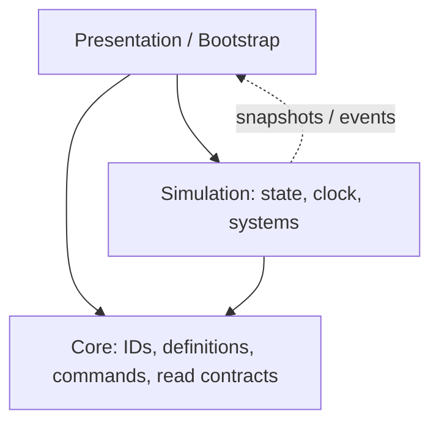

# Architecture — baseline v0.2

[AGENTS](../../AGENTS.md) · [ECS](ECS.md) · [Simulation](Simulation.md) · [CodingStandards](CodingStandards.md) · [Testing](Testing.md)

## Цели

Возможность запустить и проверить симуляцию без графики/сцены; постоянные NPC; один авторитетный владелец состояния; короткий путь к A. Не реализовывать полноценную layered/clean architecture, DI-фреймворк и шесть обязательных сборок до необходимости.

| Технология | Решение |
| --- | --- |
| Unity | 6.6; точная сборка из ProjectSettings/ProjectVersion.txt |
| Рендер | URP Universal 2D, ортографическая камера |
| Язык/платформа | C#, профиль выбранного Unity; PC/Windows |
| Ввод | Input System; действия, а не зашитые клавиши |
| Камера и анимация | Cinemachine/2D Animation по необходимости |
| AI | FSM и простые приоритеты |
| Данные | ScriptableObject authoring → runtime definitions; состояние отдельно |
| Simulation | Pure C# либо Unity Entities после P0; tick-based |
| Представление | GameObjects, SpriteRenderer, Animator; отдельный эксперимент с instancing |

Не менять обязательные зависимости без согласования. Использовать установленный manifest и lock, а не предположения о версии пакета. Unity 6.7 LTS проверять в отдельной ветке после стабильного релиза: импорт, compile, тесты и тот же benchmark. Не строить MVP на экспериментальном CoreCLR или Physics Core 2D.

## Три стартовых модуля



Стрелки с полными линиями — ссылки сборок, пунктир — поток данных, не зависимость кода.

- **Core:** чистые C# ID, value types, определения, команды и минимальные read contracts. Без UnityEngine, Entity handles, сцен и UI.
- **Simulation:** авторитетное состояние, правила, очереди, системы, session/tick. Чистый C# для managed backend; при выборе Entities допустимы зависимости от DOTS в Simulation, но не GameObjects/Scene/UI. Не нужно делать все функции интерфейсами.
- **Presentation:** Unity input, player/camera, views, анимации, UI, authoring адаптеры и composition root. Инициализирует одну сессию, читает состояние, отправляет команды. Animator не наносит урон, UI не выдаёт хлам.

Persistence/Infrastructure, отдельный Editor и Bootstrap выделяются по реальной потребности; не обязаны быть самостоятельными сборками A. Порты хранения определяются на внутренней стороне при появлении сохранений; внешняя реализация не диктует правила. Не переносить игровую логику в «сервисы» ради схемы.

## Предлагаемые пути

```text
Assets/_ScrapNation/
  Art/
  Audio/
  Prefabs/
  Scenes/
  Settings/
  Scripts/
    Core/
    Simulation/
      NPC/
      Resources/
      Economy/
      # Combat, Buildings, World... по мере появления
    Presentation/
      Bootstrap/
      Input/
      Views/
      UI/
      # Authoring, Persistence по мере необходимости
    Editor/
  Tests/
    EditMode/
    PlayMode/
Docs/
  GameDesign/
  Architecture/
```

Создавать только используемые папки. Namespace ScrapNation.Core, ScrapNation.Simulation.[Feature], ScrapNation.Presentation.[Feature]. Начальные asmdef по фактическим трём границам и отдельные тестовые/editor сборки, когда нужны. Core с noEngineReferences; для чистой managed Simulation тоже, если зависимости позволяют. При ECS изменить Simulation asmdef осознанно. Не допускать циклов. Если Unity лежит в подкаталоге, использовать реальный корень проекта.

## Authority и будущее

Один владелец состояния и команды/read models. В A–C локальный владелец. Если позднее будет онлайн, целевое направление server-authoritative, валидируемые команды и snapshots. Не делать сегодня транспорт, prediction, rollback, аккаунты или backend. Один backend симуляции не означает, что сеть уже готова.
