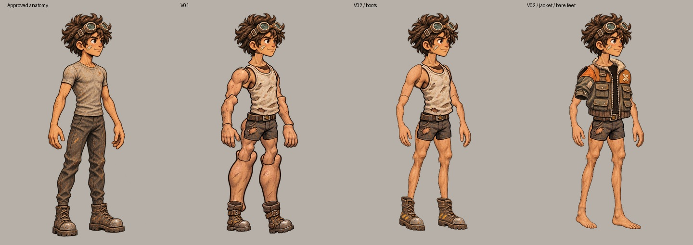
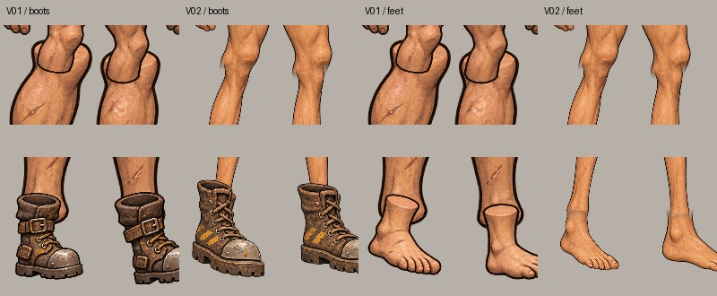
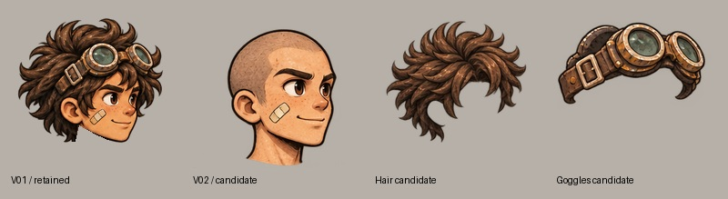

# 002 · Humanoid Assembly V02

28 ноября 2026. Стадия P0. Эксперимент на одном герое, база `f21abae`. Цель — проверить замену графики без переноса суставов и правок кривых V01.

## Сравнение в нейтральной позе

Руки стали тоньше, ширина голени уменьшилась. В нейтральной позе край ближнего ботинка закрывает голень, у колена исчез крупный чёрный овал V01. На увеличении видна складка вдоль бокового края колена и линия посадки босой стопы. Ботинки тяжелее по силуэту, чем на анатомическом референсе. Оценка пропорций по этому листу качественная.

## Происхождение графики и регистрация

| Модули | Исходник | Решение |
| --- | --- | --- |
| 2 бедра, 2 голени, 2 стопы, 2 ботинка | Legs V02 | Верхний ряд Near, нижний Far. Поперечный масштаб голени подогнан к отверстию голенища. Плавные маски смягчают дистальные края бедра и голени. Верх босой стопы подогнан по маске голени в нейтральной позе. |
| 2 плеча, 2 предплечья, 2 кисти | Arms V02 | Первые две колонки. Концы сегментов зарегистрированы по плечу, локтю и запястью соответствующей стороны. |
| Корпус куртки | Additional/EquipmentAtlas V02 02 | Корпус с меховым воротником без красного платка. Шарф V01 живёт на отдельном renderer. |
| 2 рукава | Clothing V02 | Отдельные ближний и дальний рукава укорочены до участка над локтем и закреплены на UpperArm. |
| Шея, майка, таз, шарф, объединённая голова | Производные V01 | Прямые ссылки на оригинальные Sprite из V01. |

На основном листе одежды красный шарф встроен в корпус. У первого кандидата головы V02 длиннее нижняя часть лица, изменились линия челюсти и выражение глаз. Использован предусмотренный fallback. Открытые пиксели лица, волосы и очки приходят из того же спрайта, что и в V01.

[Сценарий подготовки](../../../Tools/HumanoidAssemblyV02/prepare.py) содержит окна исходников, пары ориентиров, продольную и поперечную шкалы. Он читает координаты суставов из [layout V01](../../../Tools/HumanoidAssemblyV01/layout.json). Центры обрезанных RGBA и смещения относительно кости записаны в [layout V02](../../../Tools/HumanoidAssemblyV02/layout.json). Рабочий холст 543 × 724 px, начало слева сверху. Для отделения фрагмента используется связная область с α ≥ 80 и допуск три исходных пикселя по краю. Внутри маски сохраняется исходная полупрозрачность. Это особенно существенно для Legs V02, где 45,58% листа имеет α 1–12.

Версии из проекта: Unity 6000.6.11f1, URP 17.6.0, 2D Animation 16.0.1, Test Framework 1.8.0. Источники и их статусы опубликованы в [каталоге V02](../../../ArtSource/Characters/Humanoid/Generated/V02/README.md). Обе инвентаризации проверены по SHA-256, 13/13 и 17/17.

## Сборка и воспроизведение

[Prefab](../../../Assets/_ScrapNation/Experiments/HumanoidAssemblyV02/SN_Humanoid_V02.prefab) содержит один Animator, один SortingGroup, 16 суставов и 22 SpriteRenderer. Пять спрайтов общие с V01, 17 производных находятся в Art/HumanoidAssemblyV02. Два новых renderer отвечают за рукава. Animator Controller, Idle (2 с), Walk (1 с) и Work (1,5 с) используются по ссылке из V01. Импорт производных — Single, Full Rect, центральный pivot, 360 PPU, Bilinear, uncompressed, mipmaps off, alphaIsTransparency on.

Открыть [сцену V02](../../../Assets/_ScrapNation/Experiments/HumanoidAssemblyV02/SN_Humanoid_Assembly_V02.unity) и войти в Play Mode. Клавиши 1/2/3 запускают Idle/Walk/Work. C переключает комплект, E — шарф, B — обувь, F — направление. Для повторной съёмки сохранённого prefab выбрать **Tools → Scrap Nation → Capture Humanoid Assembly V02**. Камера 280 × 280 px снимает по 48 фаз с шагом 1/48 длительности. В каждом клипе 2 × 2 × 2 × 2 состояния. Зелёный фон камеры удаляется при подготовке обзора. Светлый, тёмный и фрагмент утверждённого концепта местности используются для композитинга. Освещение игровой сцены отдельно не проверялось.

Производные пересобираются командой `python Tools/HumanoidAssemblyV02/prepare.py` с Pillow. Для регенерации Unity-ассетов использовать чистые выходные пути prefab и сцены в отдельной копии и команду **Bake Humanoid Assembly V02**. Baker до настройки импортёров проверяет оба пути и их .meta. Для построения листов и видео выполнить `python Tools/HumanoidAssemblyV02/review.py` с Pillow, NumPy и FFmpeg. Тесты запускаются в EditMode и PlayMode. С переменной `SN_CAPTURE_V02=1` PlayMode-тест дополнительно записывает кадр камеры Work в `Library/HumanoidV02PlayMode.png`.

## Результаты приёмки

| Критерий | Итог | Наблюдение |
| --- | --- | --- |
| 17 оригиналов V02 | PASS | Все PNG декодированы. Байты ZIP, рабочей копии и объектов Git совпали. |
| Сохранность V01 | PASS | Оригиналы, GUID, prefab, сцена, клипы и отчёт V01 сохранены. |
| Переиспользование скелета и клипов | PASS | Тест сравнивает пути и локальные position/rotation/scale всех 16 суставов, ссылку на controller и разрешение каждой привязки. |
| Пропорции относительно утверждённого героя | FAIL | Руки и голени ближе к эталону, но особенно дальний ботинок выглядит слишком массивным. |
| Колени без заметных срезов | FAIL | Прежние крупные открытые овалы устранены. На крупном изображении сбоку остаётся выступ края сегмента, особенно при сгибе в Walk. |
| Голени внутри ботинок | PASS | В проверенных фазах голени входят в голенища. На обеих опорных полуфазах точка подошвы выдержала допуск 1 исходный px по X/Y и 0,15° наклона. |
| Рукава следуют за руками | PASS | Оба привязаны к своему UpperArm. После коррекции верхушки рукава плечо закрыто в Work, прежнего неподвижного пустого рукава нет. |
| Независимая смена шарфа | PASS | В варианте без шарфа остаётся меховой воротник. Смена состояния видна в пикселях у обоих комплектов. |
| Лицо героя | PASS | Использован тот же объект Sprite головы, что в V01. |
| Независимые волосы и очки | FAIL | Объединённая голова V01. Снятие слоёв в Unity не проверялось. |
| Idle, Walk и Work целиком | PASS | 48 фаз каждого клипа, по 768 захватов на клип. Просмотрены полные фазовые листы и увеличенные стыки. |
| Смена экипировки сохраняет фазу | PASS | В PlayMode после каждого сочетания проверены текущий клип, normalizedTime и идентичность экземпляра GameObject. |
| Оба направления | PASS | Все 16 сочетаний в каждой фазе. Минимальное пересечение/объединение силуэтов зеркальной пары — 0,999878. |
| Регрессия V01 | PASS | Прошли три исторических EditMode-теста и один исторический PlayMode-тест. |
| Три замечания PR №7 | PASS | Baker проверяет пути до записи. Тест подтверждает каждую видимость отдельно. Съёмка перебирает направление независимо от одежды, обуви и шарфа. |
| Пользовательские изменения | PASS | Изолированный worktree. Изменённые настройки и ZIP основной рабочей копии исключены из ветки. |

Финальные результаты Unity — 6/6 EditMode и 2/2 PlayMode. В одном процессе проверены два входа в Play Mode с выходом между ними и отключённым Domain Reload. При опросе Console во время финального EditMode-прогона — 0 ошибок, 2 предупреждения. В журнале компиляции сохранились два предупреждения устаревшего API поиска в тесте V01. Постоянный ID симуляции и игровой свет — NOT TESTED.

В первом захвате первая правая фаза Idle содержала ошибочные детали. Добавлен прогрев камеры, затем весь набор снят заново. На итоговых 2 304 кадрах сравнение зеркальных силуэтов прошло. При отдельной смене шарфа изменялись минимум 269 пикселей, обуви — 1 300, одежды — 2 246 на кадре 280 × 280 при пороге изменения канала больше 24. Эти измерения проверяют видимость переключателя; художественная оценка стыков приведена отдельно. [Метрики по клипам](HumanoidAssemblyV02/capture-results.json).

[Кадр камеры в Play Mode](HumanoidAssemblyV02/playmode.png) · [64, 96 и 160 px на трёх фонах](HumanoidAssemblyV02/scales.jpg) · [Idle](HumanoidAssemblyV02/idle-phases.jpg) · [Walk](HumanoidAssemblyV02/walk-phases.jpg) · [Work](HumanoidAssemblyV02/work-phases.jpg) · [Видео всех сочетаний, 40,5 с](HumanoidAssemblyV02/cycles.mp4).

На 64 px различимы разворот и движение рук, при этом коричневая одежда теряется на фоне лавки. На 96 px читаются обувь и контраст шарфа. На 160 px заметнее переходы суставов и масса носка ботинка. Для масштаба использована высота нейтральной фигуры, поэтому вертикальное движение персонажа в цикле сохраняется.

## Задания на дорисовку

1. **Голова.** На холсте 543 × 724 с осью (265,139) зафиксировать видимый контур носа, щёк, подбородка, пластыря и глаз по [утверждённой анатомии](../../../ArtSource/References/Approved/Characters/SN_Humanoid_Anatomy_V01.png). Дорисовать лоб и затылок под волосами, волосы под ремешком, оставить 8–12 px скрытого запаса. Сдать три совмещённых RGBA с одним pivot. Проверить четыре комбинации волос/очков и наложение открытого лица на V01.
2. **Колени.** На центрах Near (226,463) и Far (306,467) убрать боковой выступ края бедра. Замкнуть объём коленной чашечки и согласовать тени бедра и голени в 12–18 px зоны перекрытия. Сверить нейтраль и перенос ноги по всем 48 фазам Walk.
3. **Стопа и ботинок.** От лодыжек (195,616) и (308,615) сверить пятку, объём носка и проекцию подошвы с эталоном. Сохранить глубину посадки и повторить тест опорной фазы. У босой стопы убрать остаточный переход материала вокруг лодыжки.

V02 пригоден для продолжения прототипа и проверки экипировки. Для серийного выпуска требуется повторная художественная приёмка коленей, обуви и раздельных слоёв головы. Этап P0 и объём Prototype A сохраняются.
