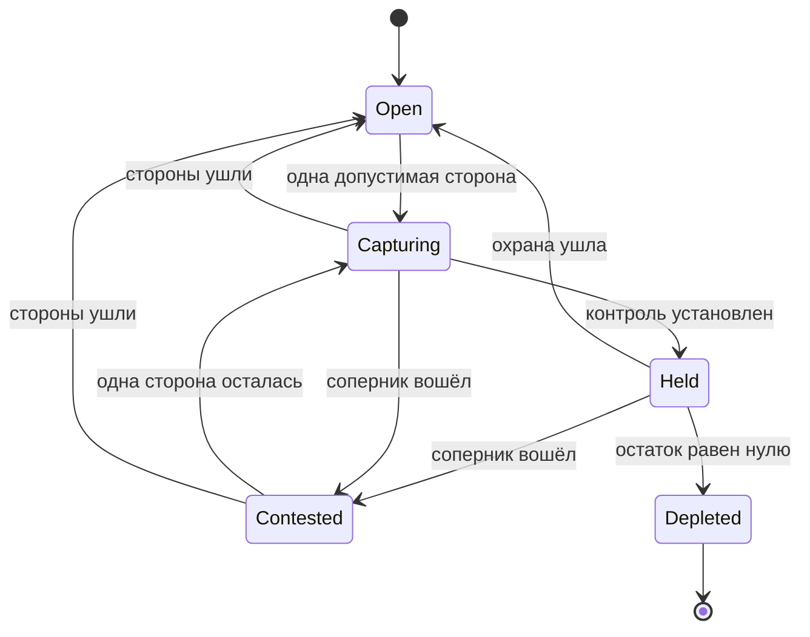

# Экономика, давление, ресурсные споты и караваны

[Концепция](Concept.md) · [NPC](NPC.md) · [Параметры MVP](MVP.md)

Правила ниже вводятся по этапам A → B → C. Целые единицы хлама и личный прогресс — достаточно для A–C. Кредиты, торговля, репутация, разные материалы и производство — последующие эксперименты.

## Учёт ресурсов

Запас залежи → груз NPC / временная экипировка → городской склад → строительство, стандартная экипировка или расход. Для взаимозаменяемого хлама используем количества по владельцу, а не уникальные ID каждого предмета. Транзакция проверяет обе стороны и меняет их в одном логическом действии. Если не хватает ресурса, отклонить действие либо явно определить частичную партию.

Сдача хлама одновременно перемещает материал на склад и начисляет личный прогресс NPC; прогресс не является второй копией хлама. Метание из тележки, потеря брони, расход на ремонт и строительство — явные списания. Появление новой залежи/сброс — явный источник. Городская награда за спот только за реально доставленный материал.

Стартовая гипотеза A: три временных элемента брони стоят по единице хлама. При успешном улучшении снять все 3 элемента, зачислить 3 единицы и списать 2 на новый стандартный комплект (чистое изменение склада +1); операция целиком валидируется до изменения. Для сборщика 2 единицы из склада оплачивают гарпун. Стоимость экипировки учитывать в богатстве, но не считать её одновременно свободным ресурсом. Не превращать старый комплект в бесплатный доход бесконечными повторными улучшениями.

## Строительство и восстановление

Флаг, ломбард, металлоприёмник (A); ограда, ремонт (B). Здание объявляет рабочие слоты/возможности, а не непосредственно исполняет всё поведение NPC. Проверить стоимость, свободную площадку, границы. Интерфейс показывает причину отказа и последствия приоритетов.

Не допустить экономического тупика: при исчерпании ближайшей кучи показать доступную альтернативу; в C стартовый район/караван должны иметь достижимую базовую залежь или бесплатный аварийный способ возобновить сбор. Предложение для теста: небольшая доступная куча, не бесплатный бесконечный склад. Не обещать гарантированное выживание при потере жителей.

## Угроза (B/C)

Концептуальная модель, коэффициенты и единицы ещё не сбалансированы:

```text
Threat = RegionRisk + kw * Wealth + kt * DwellTime + Notoriety
```

- RegionRisk: базовая опасность района.
- Wealth: оценка уникального имущества общества (склад, переносимый груз, экипировка и здания; без двойного учёта). Конвертация склада в постройку не должна резко сбрасывать давление.
- DwellTime: игровое время в текущей стоянке, единицы определены в конфиге; не реальное время.
- Notoriety: небольшая сохраняемая известность общества, не сбрасывается переездом. В C может быть простым числом; полноценная дипломатия не нужна.

Компоненты неотрицательны; нормировать шкалы и ограничить скорость роста/допустимые бюджеты. Давление влияет на частоту, состав и бюджет волн, а не напрямую умножает здоровье каждого противника. Предупреждать об угрозе и оставлять время восстановления. Опасные районы дают более ценные возможности, а не только наказание.

## Ресурсный спот (B)

Локальная ценная залежь появляется после предупреждения. Фракция отправляет охрану и сборщиков, конкурент ИИ делает то же. Игрок определяет приоритет/мобилизацию, не управляет каждым NPC. Охрана удерживает спот; добыча требует свободных рабочих. Одни и те же NPC не находятся одновременно на базе и споте.



Open/Capturing/Held/Contested/Depleted — состояния контроля и остатка, Extracting — работа при Held, Lost — событие потери контроля, а не отдельное состояние. При Contested или потере охраны захват и новые операции извлечения останавливаются; незавершённое извлечение отменяется/приостанавливается без списания (MVP: отменить, освободить слот). Уже переносимый груз можно вывезти. Успешная доставка остаётся у владельца даже при смене контроля. Последнюю единицу нельзя забрать дважды.

Позже на глобальной карте такие события привлекают экспедиции нескольких игроков. Реальный онлайн, дальние регионы и общий сервер не входят в MVP.

## Караван (C)

Решение «остаться или переехать» возникает из истощения, угрозы и возможностей нового района. Переезд доступен по выбору после появления возможности, не обязателен по таймеру. Переносятся жители, ID, профессии, здоровье, экипировка, личный прогресс и допустимый груз. Выбор района: обычный/рискованный, заранее читаемая разница награды и угрозы. Переносимые достижения не исчезают вместе с базой.

Здания остаются; при допустимом разборе возвращается часть стоимости. Время стоянки сбрасывается, известность и переносимое богатство сохраняются. Ограниченная вместимость и потеря инфраструктуры — цена переезда. Не разрешать получать повторно бесплатные стартовые ресурсы через циклическую миграцию; каждый регион/сброс создаёт материал по явному правилу.

MVP: один переезд с повторным использованием сцены и snapshot в памяти. В C достаточно небольшой восстановленной инфраструктуры и видимой работы знакомых NPC. Не нужны физический путь каравана, бесшовный мир и дисковое сохранение до отдельной проверки.
