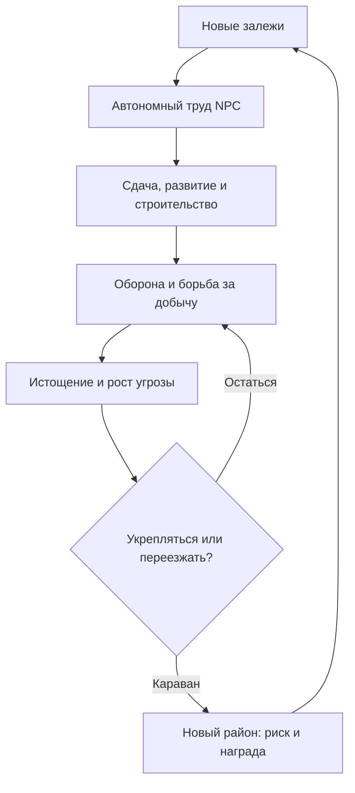

# SCRAP NATION

> **Корпорации выбрасывают мусор. Игрок строит из него государство.**  
> Build a civilization from what the world threw away.

2D Side-scrolling Colony Sim / Survival Strategy / Base Building

**Концепция:** Pre-GDD v0.2. Текущая стадия, состояние билда и следующий шаг: [PROJECT_STATUS.md](PROJECT_STATUS.md).

| Движок | Рендер | Язык | Первая платформа |
| --- | --- | --- | --- |
| Unity 6.6 | Universal 2D (URP) | C# | PC / Windows |

## Концепция

Земля поделена между мегакорпорациями. Списанная техника, промышленные отходы и всё, что потеряло ценность для корпоративного мира, отправляются на гигантские свалки. За десятилетия на них возникли поселения, торговля, враждующие группировки и мутанты.

Герой объединяет жителей свалки, защищает территорию и создаёт производство. NPC приходят в поисках работы, собирают хлам, меняют экипировку и самостоятельно развивают профессии. Чем успешнее общество, тем больше внимания оно привлекает. Когда залежи истощаются, игрок может вывезти людей и имущество в другой район. В финальной перспективе независимый индустриальный город вступает в противостояние с корпорациями.

**База временна. Цивилизация постоянна.**

| Дизайн-опора | Игровое обещание |
| --- | --- |
| Самоорганизация | Создаём возможности, а NPC самостоятельно работают, зарабатывают и развиваются. |
| Живая свалка | Старые залежи истощаются, новые сбросы меняют направления развития. |
| Кочевая цивилизация | Богатство и время стоянки повышают угрозу; переезд сохраняет достижения людей. |
| Борьба за добычу | Ценную точку нужно удержать, извлечь ресурсы и доставить груз. |



Первая пара веток: **сборщик с тележкой → ломбард → гарпунщик** и **барахольщик → металлоприёмник → железник**. Продвинутые жители сохраняют мирную рабочую функцию. Герой управляет инфраструктурой и приоритетами, а не покупает каждого бойца.

В перспективе ресурсные споты появляются на глобальной карте; конкурирующие игроки отправляют экспедиции и борются за контроль и вывоз добычи. MVP — одиночный, конкуренты управляются ИИ.

## Визуальное направление

Рисованная модульная 2D-графика: детализированные спрайты с отдельными частями тела, одежды и экипировки, преимущественно скелетная анимация. Основной AI-инструментарий — **ChatGPT Images + Codex**: концепты и исходная графика, обработка ассетов и автоматизация Unity. Подробнее — [Concept / Визуальное направление](Docs/GameDesign/Concept.md#визуальное-направление).

Утверждены концепт игрового экрана, ракурс персонажей ¾ при боковой ортографической камере, внешность героя и анатомический референс. Созданы экспериментальные листы тела A/B/C; совместимость с rig не проверена. См. [Art Direction](Docs/GameDesign/ArtDirection.md) и [каталог исходников](ArtSource/README.md). P0 и Prototype A не зависят от финального арта.

## План проверки интереса

Прототипы A–C — последовательные версии одного проекта, а не три отдельные игры. Не переходить к следующей ступени до плейтеста предыдущей.

| Этап | Содержание | Проверяемый результат |
| --- | --- | --- |
| P0 — техническая основа | Герой, камера, конечная куча, сборщик, сдача; короткий ECS-spike | Выбрана одна реализация симуляции; сбор и сдача работают без потери/дублирования ресурсов |
| A — Живая свалка (3–5 мин) | Две профессии, ломбард, металлоприёмник, приоритеты, видимый прогресс | Игрок сам замечает улучшения и хочет выращивать следующих жителей |
| B — Борьба за ресурсы (5–10 мин) | Ограда, тревога, нападение, ресурсный спот, ИИ-конкурент | Выбор между работой, обороной, добычей и отступлением имеет последствия |
| C — Кочевая цивилизация (15–20 мин) | Истощение, рост угрозы, выбор риска, переезд с сохранением NPC и груза | Игрок понимает, что сохранил, и хочет продолжить развитие |

**Первый внешний плейтест — уже после A.** Не ждать дисковых сохранений, глобальной карты, мультиплеера, продакшен-арта, сложного AI или всей кампании. Метрики, сценарии и параметры: [MVP](Docs/GameDesign/MVP.md).

## Техническое направление

- **Hybrid / ECS-ready.** Правила симуляции не зависят от наличия визуальных объектов и сцены.
- На P0 сравниваем минимальный C#-цикл и небольшой Unity Entities spike на одинаковой задаче. Принимаем решение до разрастания NPC-систем; не поддерживаем две production-реализации.
- Три стартовых модуля: Core (контракты), Simulation (состояние и системы), Presentation (Unity-интеграции, ввод, виды). Bootstrap находится на внешней стороне; persistence выделяется по мере необходимости.
- Фиксированный tick: предварительно 20 Hz. FSM для задач NPC; профессия, задача, активность и боевой режим разделены. Постоянные ID; ScriptableObject для авторинга.
- SpriteRenderer + SortingGroup для сложных персонажей. RenderSprite/RenderSpriteInstanced, Jobs/Burst и Physics Core 2D оцениваем отдельно по измерениям.
- Unity 6.7 LTS — кандидат после стабильного релиза и проверки совместимости. Будущий онлайн server-authoritative; не часть MVP.

## Документация

**[AGENTS.md](AGENTS.md)** — обязательный короткий регламент для разработчиков и AI-агентов.

[PROJECT_STATUS.md](PROJECT_STATUS.md) — оперативное состояние проекта. [DocumentationPolicy.md](Docs/DocumentationPolicy.md) — когда создавать и обновлять ADR, отчёты экспериментов, плейтесты и остальные документы. Задачи и дефекты отслеживаются в [GitHub Issues](https://github.com/redbull101020/SCRAP-NATION/issues).

| Геймдизайн | Архитектура |
| --- | --- |
| [Концепция и мир](Docs/GameDesign/Concept.md) | [Обзор и границы модулей](Docs/Architecture/Overview.md) |
| [NPC, профессии и поведение](Docs/GameDesign/NPC.md) | [ECS и план принятия решения](Docs/Architecture/ECS.md) |
| [Экономика, угроза, споты и караваны](Docs/GameDesign/Economy.md) | [Симуляция, идентичность и сохранения](Docs/Architecture/Simulation.md) |
| [MVP, баланс и плейтесты](Docs/GameDesign/MVP.md) | [Coding standards и Unity-ассеты](Docs/Architecture/CodingStandards.md) |
| | [Тестирование и Definition of Done](Docs/Architecture/Testing.md) |

## Как начать разработку

После загрузки Unity-проекта:

1. Установить Unity Hub и точную версию Unity из `ProjectSettings/ProjectVersion.txt` (ветка 6.6).
2. Установить Git; Git LFS нужен для согласованных LFS-ассетов.
3. Клонировать репозиторий:
   ```sh
   git clone https://github.com/redbull101020/SCRAP-NATION.git
   cd SCRAP-NATION
   ```
4. Через Unity Hub открыть каталог, содержащий `Assets`, `Packages` и `ProjectSettings`; дождаться импорта.
5. Прочитать AGENTS.md, PROJECT_STATUS.md и документацию затронутой системы. Когда появится сцена прототипа, открыть её и запустить Play Mode.

Точная версия редактора, установленные пакеты и реальные пути определяются файлами проекта, а не предварительным планом.

## Референсы

| Игра | Что изучаем |
| --- | --- |
| [Until We Die](https://store.steampowered.com/app/1197570/Until_We_Die/) | Герой на боковой карте, распределение задач, оборона и нарастающее давление |
| [Kingdom Two Crowns](https://store.steampowered.com/app/701160/Kingdom_Two_Crowns/) | Косвенное управление, горизонтальная карта, читаемые границы |
| Majesty: The Fantasy Kingdom Sim | Автономные герои и экономические стимулы |
| Oxygen Not Included | Живая колония и взаимосвязанное производство |
| Kenshi | Ценность людей, опасные районы, кочевое развитие |
| Frostpunk | Индустриализация, давление среды и управленческие дилеммы |

Референсы — материал для анализа, а не перечень механик или ассетов для копирования. Первые визуальные эталоны утверждены; конкретные параметры рендера, rig и импорта требуют проверки. Финальная экономика, глобальная карта, правила PvP и бизнес-модель также требуют решений.

---

SCRAP NATION — симулятор рождения цивилизации на обломках другой цивилизации.
