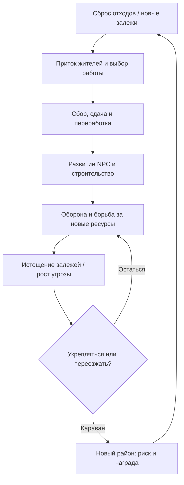
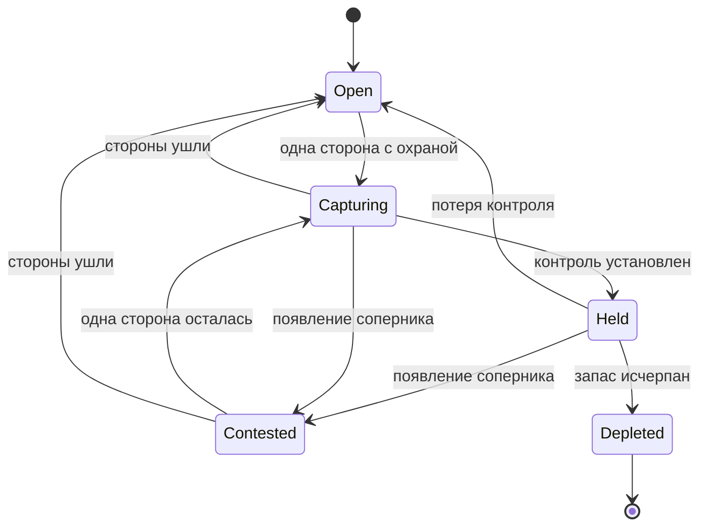

# SCRAP NATION

> **Корпорации выбрасывают мусор. Игрок строит из него государство.**  
> Build a civilization from what the world threw away.

2D Side-scrolling Colony Sim / Survival Strategy / Base Building

**Статус:** Pre-production · Concept / Pre-GDD v0.1 · разработка прототипа ещё не подтверждена.

| Движок | Рендер | Язык | Первая платформа |
| --- | --- | --- | --- |
| Unity 6.6 | Universal 2D (URP) | C# | PC / Windows |

[Инструкции для разработчиков и AI-агентов — AGENTS.md](AGENTS.md)

## Концепция

Земля поделена между мегакорпорациями. Списанная техника, промышленные отходы и всё, что потеряло ценность для корпоративного мира, отправляются на гигантские свалки. За десятилетия на них возникли собственные экосистемы, поселения, торговля, враждующие группировки и мутанты.

Главный герой объединяет жителей свалки, защищает территорию, создаёт производство и превращает лагерь в независимое общество. Чем успешнее оно становится, тем больше привлекает внимание конкурентов, мародёров и в конечном счёте корпораций.

**База временна. Цивилизация постоянна.**

## Дизайн-опоры

| Опора | Игровое обещание |
| --- | --- |
| **Самоорганизация** | Игрок создаёт возможности, а NPC сами приходят, работают, зарабатывают и развиваются. |
| **Живая свалка** | Старые залежи исчезают, новые падают с неба и меняют направления развития. |
| **Кочевая цивилизация** | Рост богатства и время стоянки усиливают угрозу. Переезд сохраняет людей и их достижения. |
| **Борьба за добычу** | Ценную точку мало захватить: её надо удержать, добыть сырьё и доставить груз. |

В отличие от обычной RTS, игрок не покупает каждого бойца. Он формирует общество через размещение зданий, экономические стимулы, защиту и приоритеты. Визуальный прогресс жителей должен быть заметен даже без интерфейса.

## Игровой цикл



- **Герой:** физически присутствует на боковой карте, перемещается, исследует территорию, строит, расширяет границы, меняет приоритеты, объявляет тревогу и организует караван.
- **Жители:** самостоятельно находят доступные точки интереса, выполняют работу, развиваются и возвращаются к труду после боя.
- **Поселение:** инфраструктура одновременно приносит ресурсы, открывает профессии и защищает население. Выбор между инвестициями в экономику и оборону имеет последствия.
- **Кампания:** переход между районами, сохранение населения и технологий, рост производства, выход на глобальную карту и борьба за независимость.

## NPC и их эволюция

| Начальная профессия | Поведение | Условие развития | Продвинутая профессия |
| --- | --- | --- | --- |
| Сборщик с тележкой | Собирает предметы, сдаёт их; в бою расходует груз как метательные предметы | Личный прогресс от сдачи + доступный ломбард и ресурсы | Гарпунщик |
| Барахольщик / ближник | По одному надевает найденные элементы брони до предела; временная защита изнашивается в бою | Полный комплект + доступный металлоприёмник и ресурсы | Железник |

При улучшении сохраняются ID, имя и история NPC. Меняются его профессия, экипировка, возможности и внешний вид. В мирное время продвинутые жители продолжают приносить пользу обществу.

Каждый предмет имеет единственного владельца: залежь, NPC, склад или экипировка. Сдача пополняет городские запасы и отдельно начисляет личный прогресс. Предметы, потраченные в бою, нельзя сдать ещё раз.

В полной версии здания открывают логистов, механиков, медиков, электротехников, операторов дронов и другие профессии. MVP ограничен двумя ветками.

## Экономика, угроза и переезд

Первый прототип использует один общий ресурс **хлам** и личный прогресс жителей. Позднее возможны кредиты, разные виды сырья, репутация, торговля и производственные цепочки.

Ключевые объекты MVP: флаг лагеря, ломбард, металлоприёмник, ограда и ремонт. Здания не только расходуют ресурсы, но и меняют возможности автономных жителей.

Угроза определяется базовым риском района, богатством поселения и длительностью нахождения на одном месте. Директор угроз предупреждает о нападениях и оставляет окна восстановления. Истощение ближайших залежей и новые сбросы мусора вынуждают выбирать между расширением, борьбой за добычу и эвакуацией.

При переезде караван сохраняет жителей, их ID, профессии, прогресс, экипировку и допустимую часть груза. Инфраструктуру нужно разворачивать заново; часть материалов можно вернуть разбором зданий. Более опасные районы дают более ценные возможности. Переезд — выбор, а не обязательный сброс по таймеру.

## Захват ресурсных точек

На локальной карте ГГ периодически появляются новые ценные залежи. Игрок отправляет жителей на добычу и выделяет охрану; соперники также стремятся к ресурсу.



Оспариваемая точка приостанавливает захват и новые циклы сбора. Уже вывезенная добыча остаётся у игрока; допустим частичный успех и отступление.

В перспективе ресурсные события появляются на общей карте мира: игроки отправляют экспедиции, конкурируют за контроль, удерживают точку и эвакуируют сырьё. Отсутствующие жители не защищают базу. Для MVP конкурентом служит ИИ; реальные PvP, сервер и глобальная карта пока не входят в разработку.

## Минимальный MVP

**Цель:** проверить, интересно ли игроку наблюдать за самоорганизацией NPC, влиять на их развитие и принимать решения о добыче, обороне и переезде. Не создавать уменьшенную копию всей будущей игры.

### P0 — технический скелет

- [ ] Создать Unity 6.6 Universal 2D проект, настроить Git и базовую структуру.
- [ ] ГГ, движение, камера и одна простая горизонтальная карта.
- [ ] Централизованная симуляция с фиксированным tick и постоянными ID.
- [ ] Конечная куча мусора, один автономный сборщик, ломбард, сдача груза.
- [ ] Проверка учёта ресурса: добыча и доставка не создают хлам из воздуха.

### P1 — ядро интереса

- [ ] Две профессии и их визуальные улучшения (тележка, броня, гарпунщик, железник).
- [ ] 4–8 автономных жителей; свободные рабочие места и точки интереса.
- [ ] Флаг, ломбард, металлоприёмник, ограда, ремонт.
- [ ] Команды героя: строительство, приоритет, тревога.
- [ ] Один тип врага и первая волна; возвращение жителей к работе.
- [ ] HUD: хлам, запас залежей, угроза, причина действия NPC и прогресс развития.

### P2 — минимальный играбельный MVP

- [ ] Две конечные кучи мусора и один предупреждённый сброс.
- [ ] 2–3 волны нападений, зависимость угрозы от богатства и времени стоянки.
- [ ] Один локальный ресурсный спот с конкурентом-ИИ, добычей и доставкой.
- [ ] Выбор остаться или переехать; обычный и рискованный район на повторно используемой сцене.
- [ ] Сохранение ID, профессий, экипировки и груза при переезде.
- [ ] Локальный журнал событий и итог сессии.

### P3 — плейтест и итерации

- [ ] Сессия 15–20 минут, короткий туториал, 8–12 внешних тестеров.
- [ ] Проверка гипотез H1–H5 и сбор наблюдений без подсказки предполагаемой уникальности.
- [ ] Исправление проблем читаемости, темпа и влияния игрока.
- [ ] Повторный плейтест перед расширением объёма разработки.

### Первые параметры для балансировки

Все значения ниже — гипотезы из Pre-GDD v0.1, не окончательный баланс.

| Параметр | Стартовое значение |
| --- | --- |
| Сессия / первое улучшение | 15–20 мин / до 3–5 мин |
| Старт | Флаг, два бродяги, 12 хлама |
| Залежи | 40 и 30 единиц хлама |
| Тележка | 4 предмета, 2 сдачи до улучшения |
| Временная броня | 3 слота, один элемент за 15–30 с |
| Ломбард / металлоприёмник / ограда | По 4 хлама |
| Улучшение NPC | 2 хлама из городского запаса; сдача 3 элементов брони даёт 3 хлама до списания |
| Первое нападение / сброс / караван | Около 5-й / 7-й / с 12-й минуты |

Финал сессии: удержать лагерь до конца либо развернуть его в новом районе. Потеря всех жителей или ГГ завершает сессию досрочно. Частичная добыча — допустимый результат.

### Критерии успеха

Ориентиры для группы из 10 тестеров; при другом размере группы оценивать доли и качественные причины. Это не статистическое доказательство.

| Гипотеза | Критерий |
| --- | --- |
| H1 — автономная эволюция интересна | ≥ 7 замечают улучшение без подсказки и объясняют влияние здания |
| H2 — игрок чувствует авторство | ≥ 7 осознанно меняют приоритет или размещение и объясняют цель |
| H3 — ресурсная точка создаёт дилемму | ≥ 6 объясняют выбор добычи/охраны/отступления; часть отказывается от полной добычи |
| H4 — переезд воспринимается как прогресс | ≥ 6 считают выбор района осмысленным; уехавшие называют сохранённые достижения |
| H5 — хочется продолжить | ≥ 7 хотят ещё сессию; ≥ 5 добровольно начинают её при возможности |

Сценарий: 0–3 мин — управление и строительство; 3–6 — первые улучшения и нападение; 6–12 — сброс и конфликт за добычу; 12–20 — давление, выбор переезда и его последствия.

Минимальные события для локальной телеметрии: `spawn_npc`, `item_collected`, `deposit`, `upgrade`, `build`, `priority_change`, `raid_warning`, `raid_end`, `spot_enter`, `spot_contested`, `loot_delivered`, `migrate_choice`, `migrate_complete`, `replay_start`. Без ненужных персональных данных.

Если H1/H2 не проходят, дорабатываем ядро, а не добавляем новые профессии и контент. Если слабы H3/H4, корректируем конфликт и кочевой цикл. Если H5 не проходит, изучаем темп, повторяемость и следующую цель.

**Не входит в MVP:** онлайн, процедурная генерация мира, вертикальные многоэтажные карты, полноценная торговля, сложные потребности жителей, сюжетная кампания, продакшен-арт и десятки профессий.

## Техническое направление

| Область | Решение |
| --- | --- |
| Архитектура | Hybrid / Data-Oriented, ECS-ready |
| Симуляция | Фиксированный tick, единый авторитетный state, отделённый от Unity-сцены |
| AI | FSM для MVP; Utility AI при подтверждённой необходимости |
| Данные | ScriptableObjects для авторинга, runtime state и versioned save DTO отдельно |
| Представление | GameObjects / SpriteRenderer / Animator, URP 2D, Input System |
| Масштабирование | Jobs, Burst, Collections, Unity Entities после технического эксперимента и профилирования |
| Рендер-эксперимент | RenderSprite / RenderSpriteInstanced для массовых простых спрайтов при подтверждённой совместимости |
| Будущий онлайн | Server-authoritative; не реализуется в MVP |

На P0 используем компактную C#-симуляцию без обязательной зависимости от Entities. После рабочего вертикального среза сравниваем её с ECS на одинаковом сценарии; если ECS полезен, переносим подходящие системы, не дублируя игровые правила. Unity 6.7 LTS рассматриваем после стабильного релиза и проверки миграции.

Подробные архитектурные контракты, правила ресурсов, ID, сохранений, тестов и работы с Unity-ассетами: [AGENTS.md](AGENTS.md).

## Как начать разработку

На момент подготовки README Unity-проект ещё не загружен в репозиторий. Следующие шаги применимы после первичной загрузки:

1. Установить Unity Hub и точную версию Unity из `ProjectSettings/ProjectVersion.txt` (ветка 6.6).
2. Установить Git и Git LFS при использовании LFS-ассетов.
3. Клонировать репозиторий:
   ```sh
   git clone https://github.com/redbull101020/SCRAP-NATION.git
   cd SCRAP-NATION
   ```
4. Открыть через Unity Hub каталог, содержащий `Assets`, `Packages` и `ProjectSettings`. Дождаться импорта пакетов.
5. Когда появится сцена прототипа, открыть её и запустить Play Mode. До её создания играбельного билда нет.
6. Проверить [AGENTS.md](AGENTS.md) перед изменениями кода, сцен и зависимостей.

Предлагаемая структура (каталоги появляются по мере реализации):

```text
SCRAP-NATION/
  README.md
  AGENTS.md
  .gitignore
  Assets/_ScrapNation/
    Art/
    Audio/
    Prefabs/
    Scenes/
    Settings/
    Scripts/
      Domain/
      Simulation/
      Application/
      Infrastructure/
      Presentation/
      Bootstrap/
      Editor/
    Tests/
      EditMode/
      PlayMode/
  Packages/
  ProjectSettings/
  Docs/
```

## Референсы

| Игра | Что изучаем |
| --- | --- |
| [Until We Die](https://store.steampowered.com/app/1197570/Until_We_Die/) | Герой на боковой карте, распределение задач, оборона и нарастающее давление |
| [Kingdom Two Crowns](https://store.steampowered.com/app/701160/Kingdom_Two_Crowns/) | Косвенное управление, горизонтальная карта, читаемые границы |
| Majesty: The Fantasy Kingdom Sim | Автономные герои и экономические стимулы |
| Oxygen Not Included | Живая колония и взаимосвязанное производство |
| Kenshi | Ценность людей, опасные районы, кочевое развитие |
| Frostpunk | Индустриализация, давление среды и управленческие дилеммы |

Референсы — материал для анализа, а не перечень механик или ассетов для копирования. Арт-стиль (пиксельный или рисованный), финальная экономика, глобальная карта, правила PvP и бизнес-модель пока открыты.

---

SCRAP NATION — симулятор рождения цивилизации на обломках другой цивилизации.
